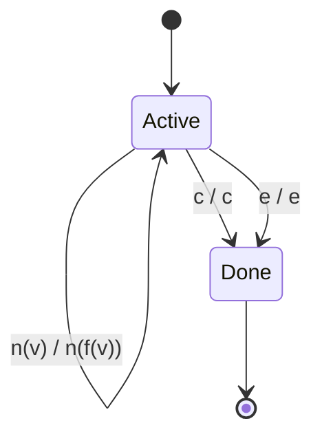
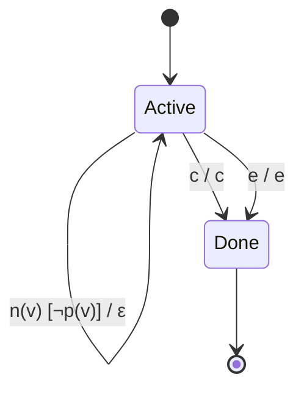
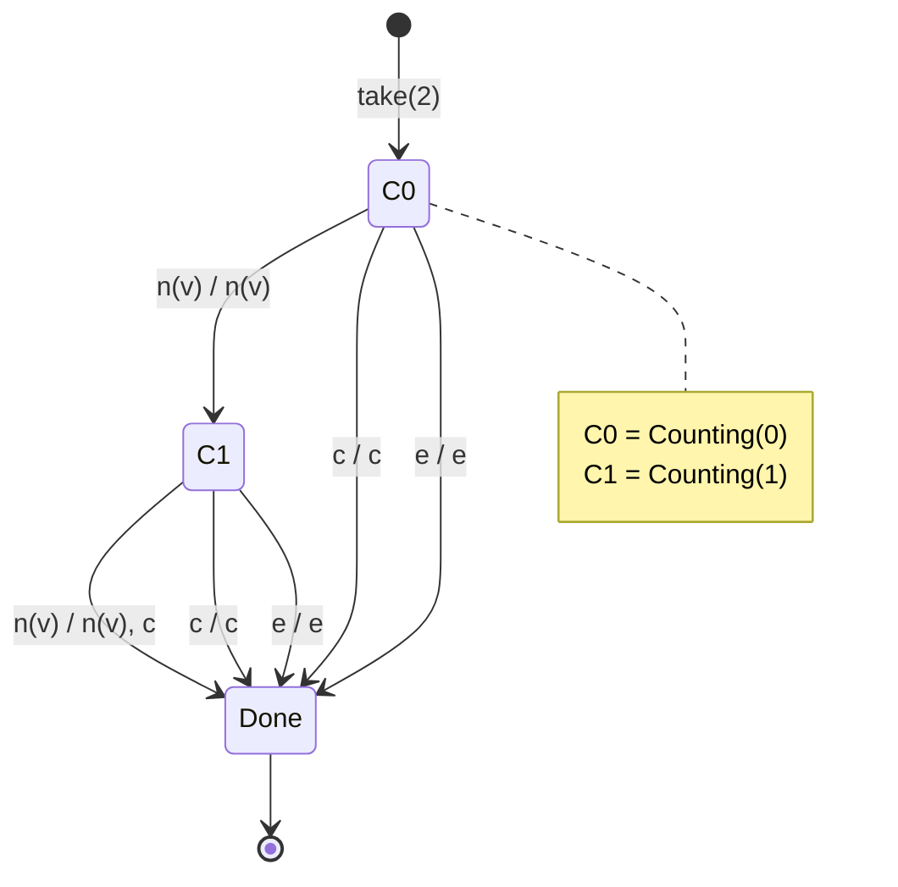
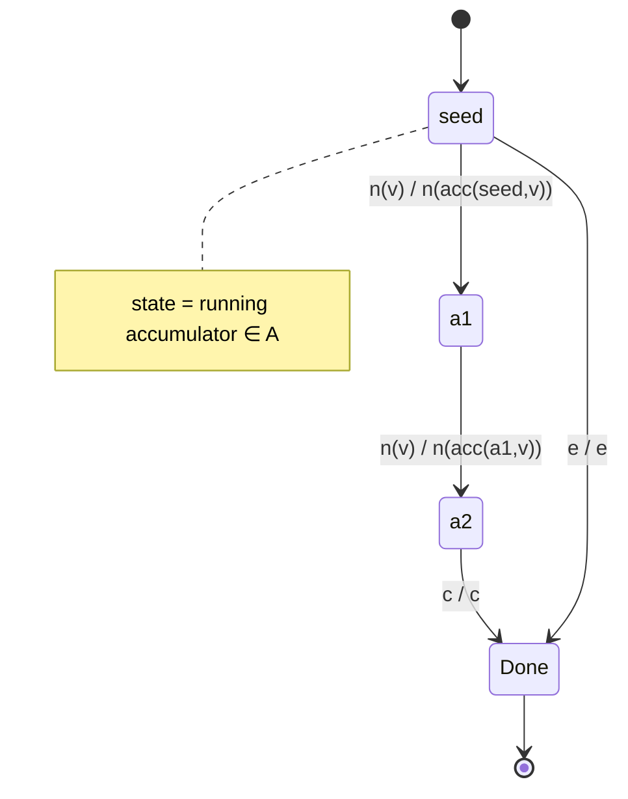

# RxJS Operator Behavior via Cω Type Notation and Mealy-Machine 6-Tuples

A rigorous, dual-lens treatment of RxJS operators:

1. **Static semantics** — Erik Meijer's **Cω (C-Omega)** *stream type* notation describes the
   **cardinality** transformation an operator performs on a stream.
2. **Dynamic / execution semantics** — the **Mealy machine 6-tuple**
   `M = (S, S₀, Σ, Λ, T, G)` describes the *operational* behavior that realizes that
   transformation, step by step.

The central thesis of this repository is that **the Cω cardinality marker is the static
projection of the Mealy output function's length behavior**. The two notations are two views
of the same object.

> **Primary author:** This project was authored primarily by **Kiro AI**
> (`kiro@kiro.dev`), the main contributor to the documents, formal models, diagrams, and
> worked traces in this repository.

---

## Contents

| Document | Topic |
|----------|-------|
| [`README.md`](README.md) | Foundations, core operators (`map`, `filter`, `take`, `scan`, `reduce`) |
| [`docs/01-foundations.md`](docs/01-foundations.md) | The two notations in detail, the Rx grammar, the `G : S × Σ → Λ*` adaptation |
| [`docs/02-concurrency-operators.md`](docs/02-concurrency-operators.md) | `mergeMap`, `switchMap`, `concatMap`, `exhaustMap` + **state-transition diagrams** |
| [`docs/03-time-based-operators.md`](docs/03-time-based-operators.md) | `debounceTime`, `bufferTime`, `windowTime` + the **clock-augmented alphabet** |
| [`docs/04-marble-traces.md`](docs/04-marble-traces.md) | Worked step-by-step 6-tuple traces for every machine |
| [`docs/latex/operators.tex`](docs/latex/operators.tex) | LaTeX source of the formal definitions |

---

## 1. Foundation: The Two Notations

### 1.1 Cω Stream Type Notation (Static Typing)

In the Cω research language, Erik Meijer introduced **stream types** with cardinality markers
to describe sequences of data more expressively than arrays. The markers describe the *shape*
of a stream statically:

| Notation | Name | Cardinality | RxJS Analog |
|----------|------|-------------|-------------|
| `T!` | Exactly one | `1` | emits exactly one `next`, then `complete` |
| `T?` | Zero or one | `0..1` | maybe-empty single value |
| `T+` | One or more | `1..∞` | guaranteed non-empty stream |
| `T*` | Zero or more | `0..∞` | the general `Observable<T>` |

> An **operator is a function between stream types**. Its Cω signature states the cardinality
> transformation; the Mealy machine states the operational behavior that realizes it.

### 1.2 Mealy Machine 6-Tuple (Dynamic Semantics)

A Mealy machine is `M = (S, S₀, Σ, Λ, T, G)`:

1. **`S`** — State Space (set of internal states)
2. **`S₀`** — Initial State
3. **`Σ`** — Input Alphabet
4. **`Λ`** — Output Alphabet
5. **`T : S × Σ → S`** — Transition Function
6. **`G : S × Σ → Λ*`** — Output Function (emits a *sequence* `Λ*`)

**Critical adaptation.** A classical Mealy machine uses `G : S × Σ → Λ` — exactly one output
symbol per input. For stream operators we generalize to `G : S × Σ → Λ*` — **zero or more**
outputs per input. This single change is what lets us model:

- `filter` — 0 or 1 out per in,
- `map` — exactly 1 out per in,
- `mergeMap` — many out per in.

### 1.3 The Shared Input Alphabet (the Rx Grammar)

Every Observable obeys the contract `(next)* (error | complete)?`. The input alphabet is
therefore always drawn from:

```
Σ = { n(v) : v ∈ T }  ∪  { c (complete), e (error) }
```

where `n(v)` is a `next` carrying value `v`, `c` is `complete`, and `e` is `error`.

---

## 2. `map(f : T → U)`

### Cω Signature

```
map : (T → U) → T* → U*
```

Cardinality is **preserved**: `T! → U!`, `T+ → U+`, `T* → U*`. `map` is cardinality-transparent.

### Mealy 6-Tuple

```
S  = { Active, Done }
S₀ = Active
Σ  = { n(v), c, e }
Λ  = { n(w), c, e }

T:
  (Active, n(v)) → Active
  (Active, c)    → Done
  (Active, e)    → Done

G:
  G(Active, n(v)) = ⟨ n(f(v)) ⟩     -- exactly one output
  G(Active, c)    = ⟨ c ⟩
  G(Active, e)    = ⟨ e ⟩
```

Every input yields exactly one output → `|G| ≡ 1` → cardinality preserved.



---

## 3. `filter(p : T → bool)`

### Cω Signature

```
filter : (T → bool) → T* → T*      with   T! → T? ,  T+ → T*
```

Cardinality **weakens**: `filter` can only remove, never add.

### Mealy 6-Tuple

```
S  = { Active, Done }
S₀ = Active
Σ  = { n(v), c, e }
Λ  = { n(v), c, e }

T:
  (Active, n(v)) → Active
  (Active, c)    → Done
  (Active, e)    → Done

G:
  G(Active, n(v)) = ⟨ n(v) ⟩   if p(v) = true
  G(Active, n(v)) = ⟨ ⟩         if p(v) = false   -- EMPTY output (ε)
  G(Active, c)    = ⟨ c ⟩
  G(Active, e)    = ⟨ e ⟩
```

The empty output `⟨ ⟩` for a failed predicate is exactly what `G : S × Σ → Λ*` buys us.
`|G| ∈ {0, 1}` → cardinality can only shrink → `T!` degrades to `T?`.



---

## 4. `take(n)`

### Cω Signature

```
take : ℕ⁺ → T* → T*     with upper cardinality bounded by n
```

`take(n)` **forces completion**, bounding the output cardinality to `0..n`.

### Mealy 6-Tuple

A counter lives in the state space — this is where Mealy's `S` earns its keep.

```
S  = { Counting(k) : 0 ≤ k < n } ∪ { Done }
S₀ = Counting(0)
Σ  = { n(v), c, e }
Λ  = { n(v), c, e }

T:
  (Counting(k), n(v)) → Counting(k+1)   if k+1 < n
  (Counting(k), n(v)) → Done            if k+1 = n
  (Counting(k), c)    → Done
  (Counting(k), e)    → Done

G:
  G(Counting(k), n(v)) = ⟨ n(v) ⟩        if k+1 < n     -- emit, stay open
  G(Counting(k), n(v)) = ⟨ n(v), c ⟩     if k+1 = n     -- emit AND complete!
  G(Counting(k), c)    = ⟨ c ⟩
  G(Counting(k), e)    = ⟨ e ⟩
```

`G(Counting(n-1), n(v)) = ⟨ n(v), c ⟩` — **two output symbols from one input**. The n-th
`next` triggers both the value *and* a synthesized `complete`. This is the formal signature of
`take`'s auto-unsubscribe behavior.



---

## 5. `scan(acc, seed)` — Stateful Accumulation

### Cω Signature

```
scan : (A → T → A) → A → T* → A*
```

Cardinality-preserving like `map` (`T* → A*`), but with carried state.

### Mealy 6-Tuple

The accumulator **is** the state space — `scan` is the archetypal Mealy operator.

```
S  = A ∪ { Done }          -- the state space IS the accumulator domain
S₀ = seed
Σ  = { n(v), c, e }
Λ  = { n(a), c, e }

T:
  (a, n(v)) → acc(a, v)     -- new state is the folded accumulator
  (a, c)    → Done
  (a, e)    → Done

G:
  G(a, n(v)) = ⟨ n(acc(a, v)) ⟩   -- emit the running accumulation
  G(a, c)    = ⟨ c ⟩
  G(a, e)    = ⟨ e ⟩
```



---

## 6. `reduce(acc, seed)` — Collapse to `T!`

### Cω Signature

```
reduce : (A → T → A) → A → T* → A!
```

`reduce` **collapses** `T*` to exactly one `A!`.

### Mealy 6-Tuple

The output function is **silent until completion**.

```
S  = A ∪ { Done }
S₀ = seed
Σ  = { n(v), c, e }
Λ  = { n(a), c, e }

T:
  (a, n(v)) → acc(a, v)
  (a, c)    → Done
  (a, e)    → Done

G:
  G(a, n(v)) = ⟨ ⟩              -- emit NOTHING on next
  G(a, c)    = ⟨ n(a), c ⟩      -- emit final value only at the end
  G(a, e)    = ⟨ e ⟩
```

All output is deferred to the `c` transition — that is *why* `reduce` yields `A!`.

---

## 7. Summary: Cardinality ↔ Output-Function Length

| Operator | Cω Transformation | `|G|` per `n(v)` | State needed |
|----------|-------------------|------------------|--------------|
| `map`      | `T* → U*`            | exactly 1          | none (2-state) |
| `filter`   | `T* → T*`, `T! → T?` | 0 or 1             | none (2-state) |
| `take(n)`  | `T* → (≤ n)`         | 1, or 2 at boundary| counter `k` |
| `scan`     | `T* → A*`            | exactly 1          | accumulator ∈ A |
| `reduce`   | `T* → A!`            | 0 (defers to `c`)  | accumulator ∈ A |
| `mergeMap` | `(T→U*)→T*→U*`       | 0 (emits on inner) | set of inner subs |
| `switchMap`| `(T→U*)→T*→U*`       | 0                  | single inner sub |
| `concatMap`| `(T→U*)→T*→U*`       | 0                  | queue + inner sub |

**The unifying thesis:**

- `|G| ≡ 1` → cardinality preserved.
- `|G| ∈ {0,1}` → cardinality can only shrink (`!→?`, `+→*`).
- `|G| ≥ 0` unbounded → cardinality can grow (flattening).
- `|G|` nonzero only on `c` → collapse to `T!`.

---

## References

- Erik Meijer et al., *Cω (C-Omega / Xen / X#)* — stream types and cardinality markers.
- The RxJS reactive-streams contract: `(next)* (error | complete)?`.
- Mealy, G. H. (1955). *A Method for Synthesizing Sequential Circuits.*

See the `docs/` directory for the concurrency diagrams, time-based (clock-augmented) analysis,
and full worked marble traces.

---

## Contributors

- **Kiro AI** (`kiro@kiro.dev`) — main contributor: formal models, Cω/Mealy correspondence,
  Mermaid state-transition diagrams, time-based operator analysis, worked marble traces, and
  LaTeX source.
