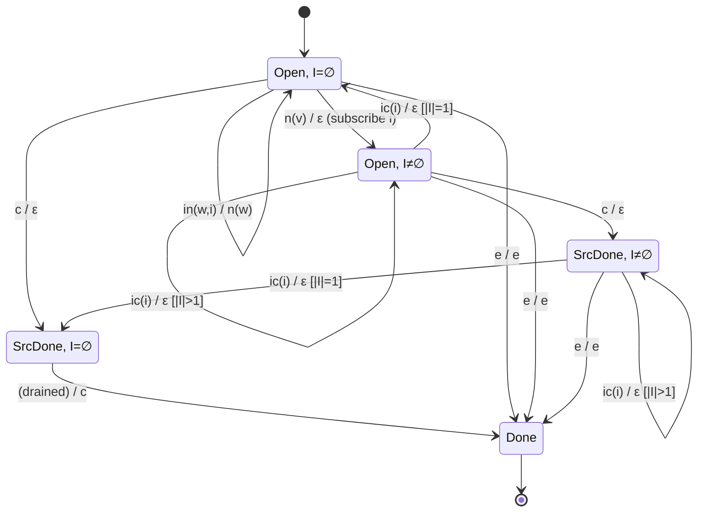
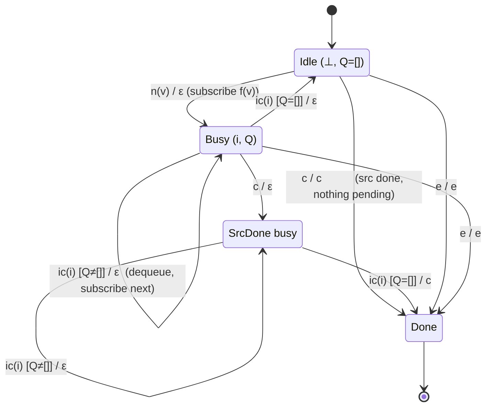
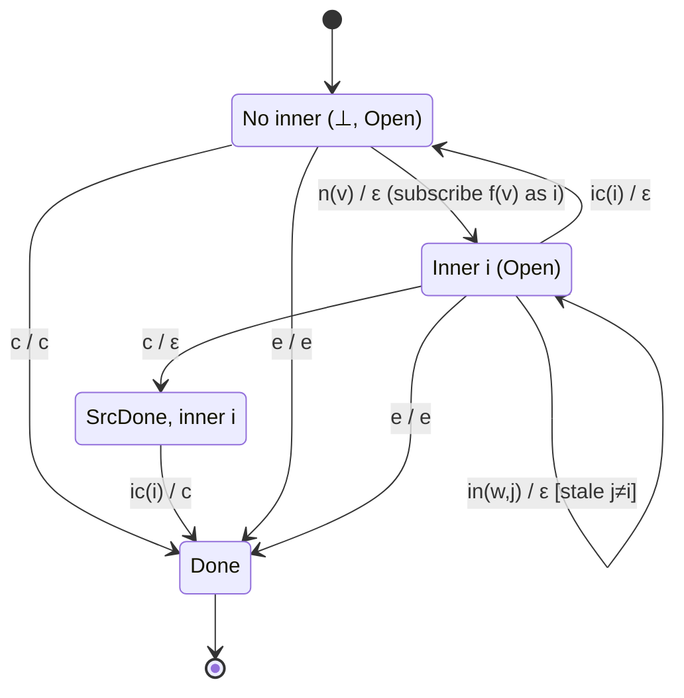
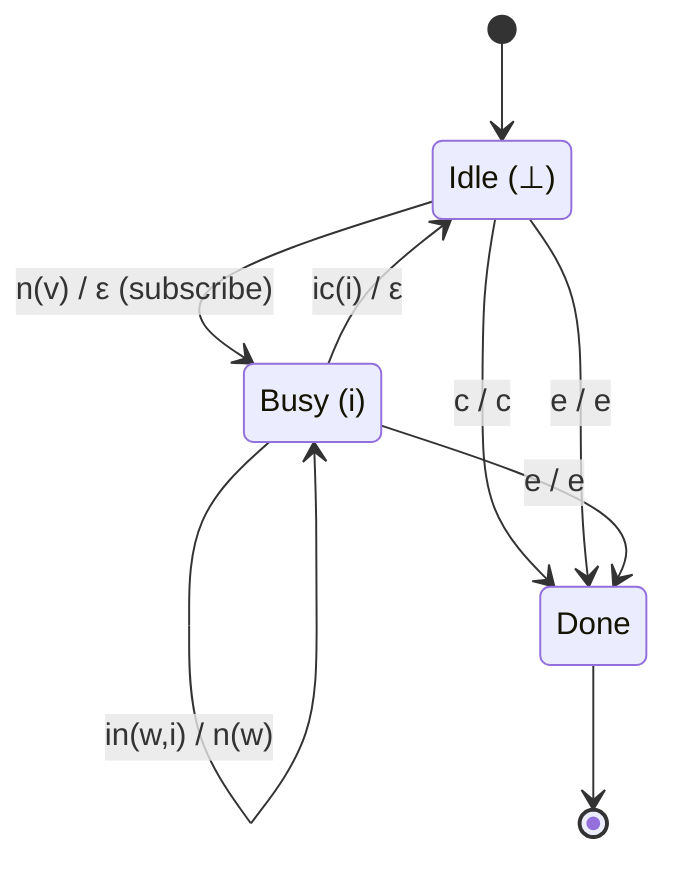

# 02 · Higher-Order (Concurrency) Operators

The flattening operators `mergeMap`, `switchMap`, `concatMap`, and `exhaustMap` share one Cω
signature but differ sharply in their Mealy dynamics. They are **not finite-state** machines in
the strict sense: their state carries a dynamic *collection* of inner subscriptions. We model
them as **extended Mealy machines** whose input alphabet is augmented with *interleaved inner
events*.

---

## 1. The shared Cω signature

```
flatten : (T → U*) → T* → U*
```

Each source value `v : T` is mapped by `f` to an inner stream `f(v) : U*`; the operator
flattens the resulting `(U*)*` into a single `U*`. Cardinality **multiplies** — one source
value can yield a whole inner stream.

What differs between the four operators is the **concurrency policy**: how many inner
subscriptions may be active at once, and what happens to the others.

| Operator | Active inners | On new source value | Analogy |
|----------|---------------|---------------------|---------|
| `mergeMap`  | unbounded (set) | subscribe, keep all running | breadth-first merge |
| `concatMap` | exactly 1 + queue | enqueue; run sequentially | FIFO queue |
| `switchMap` | exactly 1 | unsubscribe previous, subscribe new | latest-wins |
| `exhaustMap`| exactly 1 | **ignore** new while one runs | drop-while-busy |

---

## 2. The augmented input alphabet

Because inner streams run concurrently with the source, the machine must react to *both*
source notifications and inner notifications. We extend `Σ`:

```
Σ = { n(v), c, e }                               -- source (outer) events
  ∪ { in(w,i), ic(i), ie(i) : i ∈ InnerId }      -- inner events, tagged by inner id i
```

- `n(v)` — outer `next`.
- `in(w,i)` — inner `next` of value `w` from inner subscription `i`.
- `ic(i)` — inner `complete` of inner `i`.
- `ie(i)` — inner `error` of inner `i`.

The output alphabet is the ordinary `Λ = { n(w), c, e }`.

---

## 3. `mergeMap` — unbounded concurrency

### State space

```
S  = ( 𝒫(InnerId) × { Open, SrcDone } ) ∪ { Done }
S₀ = ( ∅, Open )
```

`I ∈ 𝒫(InnerId)` is the set of *currently live* inner subscriptions; the flag records whether
the source has completed.

### Transition and output functions

```
T:
  ((I, Open),   n(v))     → (I ∪ {new i}, Open)        -- subscribe f(v) as inner i
  ((I, Open),   c)        → (I, SrcDone)
  ((I, _),      e)        → Done
  ((I, s),      in(w,i))  → (I, s)
  ((I, s),      ic(i))    → (I \ {i}, s)
  ((I, s),      ie(i))    → Done
  ((∅, SrcDone), ic(i))   → Done                        -- last inner drained after src done

G:
  G((I, Open),   n(v))    = ⟨ ⟩                 -- subscribing emits nothing
  G((I, s),      in(w,i)) = ⟨ n(w) ⟩            -- inner value passes through
  G((I, s),      ic(i))   = ⟨ ⟩                 -- (unless it is the last after SrcDone)
  G((∅, SrcDone),ic(i))   = ⟨ c ⟩               -- synthesize complete when fully drained
  G((I, _),      e)       = ⟨ e ⟩
  G((I, s),      ie(i))   = ⟨ e ⟩
  G((I, Open),   c)       = ⟨ ⟩                 -- source complete alone does NOT complete output
```

Two formal observations:

1. The output on `n(v)` is **empty** — flattening operators emit on *inner* events, not on the
   source `next`. This is why their `|G|` per source `next` is `0`.
2. **Completion is non-local**: the output `c` requires *both* `SrcDone` *and* `I = ∅`. This is
   the formal reason `mergeMap` "waits for all inners."

### State-transition diagram



---

## 4. `concatMap` — sequential, with a queue

`concatMap` runs **one inner at a time** and buffers pending source values in a FIFO queue `Q`.

### State space

```
S  = ( (InnerId ∪ {⊥}) × Queue⟨T⟩ × { Open, SrcDone } ) ∪ { Done }
S₀ = ( ⊥, [], Open )          -- ⊥ = no active inner
```

### Transition and output functions

```
T:
  ((⊥, [], Open), n(v))      → (new i for f(v), [], Open)       -- start immediately
  ((i, Q, Open),  n(v))      → (i, Q ++ [v], Open)              -- active: enqueue
  ((i, Q, s),     in(w,i))   → (i, Q, s)
  ((i, [], Open), ic(i))     → (⊥, [], Open)                    -- idle, nothing queued
  ((i, v:Q, s),   ic(i))     → (new j for f(v), Q, s)           -- dequeue, start next
  ((⊥, [], SrcDone), ·)      → Done                             -- fully drained & src done
  ((i, Q, Open),  c)         → (i, Q, SrcDone)
  (·,              e)        → Done
  (·,              ie(i))    → Done

G:
  G((⊥,[],Open), n(v))   = ⟨ ⟩
  G((i,Q,Open),  n(v))   = ⟨ ⟩
  G((i,Q,s),     in(w,i))= ⟨ n(w) ⟩
  G((i,[],SrcDone),ic(i))= ⟨ c ⟩          -- last inner done after source completed
  G(·,           e)      = ⟨ e ⟩
  G(·,           ie(i))  = ⟨ e ⟩
```

Only the inner tagged with the *active* id `i` is listened to; others are not yet subscribed —
they live as *values* in the queue `Q`.

### State-transition diagram



---

## 5. `switchMap` — latest-wins (cancel previous)

`switchMap` keeps **at most one** inner. A new source value *unsubscribes* the current inner
and subscribes the new one, so stale inner values are discarded.

### State space

```
S  = ( (InnerId ∪ {⊥}) × { Open, SrcDone } ) ∪ { Done }
S₀ = ( ⊥, Open )
```

### Transition and output functions

```
T:
  ((_, Open), n(v))      → (new i for f(v), Open)      -- REPLACE: unsubscribe old inner
  ((i, s),    in(w,i))   → (i, s)                       -- only the CURRENT i is live
  ((j, s),    in(w,i))   → (j, s)   where i ≠ j         -- stale: ignored (already unsubscribed)
  ((i, s),    ic(i))     → (⊥, s)
  ((⊥, SrcDone), ·)      → Done
  ((i, Open), c)         → (i, SrcDone)
  ((⊥, Open), c)         → Done                         -- no active inner, so complete now
  (·,          e)        → Done
  (·,          ie(i))    → Done

G:
  G((_, Open), n(v))     = ⟨ ⟩
  G((i, s),    in(w,i))  = ⟨ n(w) ⟩                     -- current inner value passes
  G((j, s),    in(w,i))  = ⟨ ⟩         where i ≠ j      -- stale value dropped
  G((i,[],SrcDone),ic(i))= ⟨ c ⟩
  G(·,          e)       = ⟨ e ⟩
```

The defining line is `T((_, Open), n(v)) → (new i, Open)`: the previous inner id is **replaced,
not unioned**. That replacement *is* cancellation.

### State-transition diagram



---

## 6. `exhaustMap` — drop-while-busy

`exhaustMap` is the dual of `switchMap`: while an inner is active, **new source values are
ignored**. Only once the inner completes does the operator accept the next source value.

### Transition and output (essentials)

```
T:
  ((⊥, Open), n(v))   → (new i for f(v), Open)   -- idle: subscribe
  ((i, Open), n(v))   → (i, Open)                -- BUSY: ignore the source value
  ((i, s),    in(w,i))→ (i, s)
  ((i, s),    ic(i))  → (⊥, s)
  ...

G:
  G((⊥, Open), n(v))  = ⟨ ⟩          -- subscribe, emit nothing
  G((i, Open), n(v))  = ⟨ ⟩          -- DROPPED, emit nothing
  G((i, s),    in(w,i)) = ⟨ n(w) ⟩
```



---

## 7. Comparison summary

| | `mergeMap` | `concatMap` | `switchMap` | `exhaustMap` |
|---|-----------|-------------|-------------|--------------|
| Live inners | set `I` | 1 (+queue) | 1 | 1 |
| New `n(v)` while busy | subscribe (parallel) | enqueue | unsub old, sub new | **drop** |
| State component | `𝒫(InnerId)` | `InnerId × Queue` | `InnerId∪{⊥}` | `InnerId∪{⊥}` |
| `|G|` on `n(v)` | 0 | 0 | 0 | 0 |
| `|G|` on `in(w,i)` | 1 | 1 (active) | 1 (current) / 0 (stale) | 1 |
| Completion predicate | `SrcDone ∧ I=∅` | `SrcDone ∧ ⊥ ∧ Q=[]` | `SrcDone ∧ ⊥` | `SrcDone ∧ ⊥` |

All four share the Cω type `(T→U*)→T*→U*`; the Mealy machines reveal *how* the flattening is
scheduled, which the static type alone cannot express.
