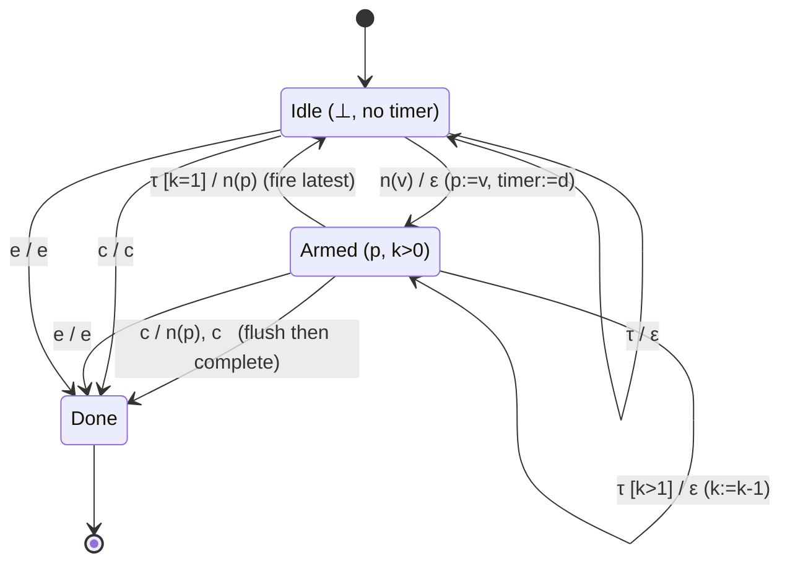
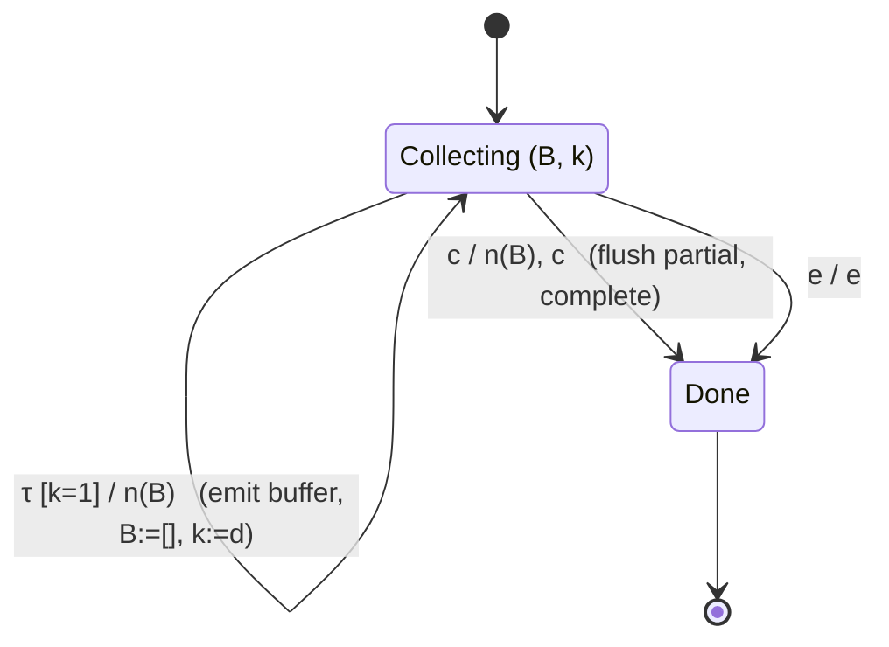
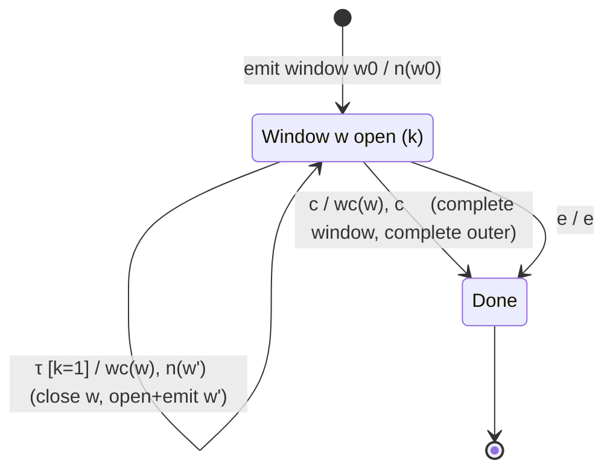

# 03 · Time-Based Operators and the Clock-Augmented Alphabet

`debounceTime`, `bufferTime`, and `windowTime` cannot be modeled by a machine that only reacts
to `next` / `complete` / `error`, because they emit **as a function of elapsed time**, even when
*no* source value arrives. To model them as Mealy machines we must make time an **input**.

---

## 1. Making the scheduler an input symbol

RxJS time operators are driven by a **scheduler** (`asyncScheduler` by default,
`TestScheduler`'s virtual clock in marble tests). We reify the passage of time as a clock
symbol in the input alphabet:

```
Σ = { n(v), c, e }  ∪  { τ }
```

- `τ` — a **tick**: the scheduler advances the virtual clock by one time unit (one frame).

A time-based machine therefore carries a **timer / counter** in its state and reacts to `τ`
just as it reacts to data. A *due* timer firing is modeled as the output produced on the `τ`
transition that crosses the threshold.

> Convention: we treat `τ` as a unit tick. A duration `d` is counted down from `d` to `0`; the
> value `0` (or `⊥` for "no timer") means "no pending deadline". `dueTime` is the operator's
> configured interval.

---

## 2. `debounceTime(d)` — emit the latest value after `d` units of silence

### Cω signature

```
debounceTime : Duration → T* → T*          with  T! → T? ,  T+ → T*
```

Like `filter`, it can only drop values (every input except the last-before-a-gap is
superseded), so cardinality weakens.

### State space

```
S  = ( (T ∪ {⊥}) × (ℕ ∪ {⊥}) × {Open, SrcDone} ) ∪ { Done }
       pending value       countdown           flags
S₀ = ( ⊥, ⊥, Open )
```

`pending` holds the most recent value awaiting emission; `timer` is the remaining ticks until
it is due (`⊥` = no armed timer).

### Transition and output functions

```
T:
  ((_, _, Open), n(v))    → (v, d, Open)              -- store value, (re)arm timer to d
  ((p, k, s),    τ)       → (p, k-1, s)      if k>1   -- tick down
  ((p, 1, s),    τ)       → (⊥, ⊥, s')       fire! (see G); s'=Done if s=SrcDone else s
  ((⊥, ⊥, Open), τ)       → (⊥, ⊥, Open)              -- idle tick, nothing pending
  ((p, k, Open), c)       → (p, k, SrcDone)   if p≠⊥   -- flush pending, THEN complete
  ((⊥, ⊥, Open), c)       → Done
  (·,            e)       → Done

G:
  G((_, _, Open), n(v))   = ⟨ ⟩                   -- never emit on arrival; just (re)arm
  G((p, k, s),    τ)      = ⟨ ⟩          if k>1   -- still counting down
  G((p, 1, s),    τ)      = ⟨ n(p) ⟩              -- quiet period elapsed → emit latest
  G((p,1,SrcDone),τ)      = ⟨ n(p), c ⟩           -- fire then complete
  G((p, k, Open), c)      = ⟨ n(p), c ⟩  if p≠⊥   -- source completes: flush immediately
  G(·,            e)      = ⟨ e ⟩
```

The key move: `n(v)` **re-arms** the timer (`→ (v, d, …)`), discarding any previously pending
value's deadline. Emission happens *only* on the `τ` that counts the timer down to zero — i.e.
after `d` ticks of silence. This is why a burst of rapid values yields a single output.

### State-transition diagram



---

## 3. `bufferTime(d)` — collect values into arrays every `d` units

### Cω signature

```
bufferTime : Duration → T* → (T[])+        (on an infinite source: T[]* of non-empty cadence)
```

The output value type changes from `T` to `T[]`. On a finite source it emits `(T[])*`; it emits
a buffer every `d` ticks regardless of whether values arrived (buffers may be empty arrays).

### State space

```
S  = ( List⟨T⟩ × ℕ × {Open, SrcDone} ) ∪ { Done }
       current buffer   ticks-left-in-window
S₀ = ( [], d, Open )
```

### Transition and output functions

```
T:
  ((B, k, Open), n(v))    → (B ++ [v], k, Open)        -- accumulate into buffer
  ((B, k, s),    τ)       → (B, k-1, s)        if k>1   -- window still open
  ((B, 1, s),    τ)       → ([], d, s)                  -- window closes: flush & reopen (see G)
  ((B, k, Open), c)       → Done                        -- flush final buffer (see G)
  (·,            e)       → Done

G:
  G((B, k, Open), n(v))   = ⟨ ⟩                 -- accumulate silently
  G((B, k, s),    τ)      = ⟨ ⟩         if k>1
  G((B, 1, Open), τ)      = ⟨ n(B) ⟩            -- emit the buffer array, start a new window
  G((B, 1, SrcDone),τ)    = ⟨ n(B), c ⟩
  G((B, k, Open), c)      = ⟨ n(B), c ⟩         -- emit the partial buffer, then complete
  G(·,            e)      = ⟨ e ⟩
```

Note `G((B,1,Open), τ) = ⟨ n(B) ⟩` fires on a **clock** symbol, not a data symbol — a value
emission with **no corresponding input value**. This is exactly what time augmentation enables:
the operator produces output in response to time alone.

### State-transition diagram



---

## 4. `windowTime(d)` — like `bufferTime`, but emits nested *Observables*

### Cω signature

```
windowTime : Duration → T* → (T*)+
```

The output is a **stream of streams** (`(T*)+`): every `d` ticks the operator emits a new inner
Observable, and routes subsequent source values into the currently open window. This is the
higher-order analogue of `bufferTime` (arrays become live Observables).

### State space

```
S  = ( WindowId × ℕ × {Open, SrcDone} ) ∪ { Done }
       current open window   ticks-left
S₀ = ( w0, d, Open )          -- the first window is opened eagerly at subscription
```

Each `WindowId` denotes a live inner `Subject` that the operator pushes into. Unlike
`bufferTime`, the window Observable is emitted **when it opens**, and values are pushed into it
*afterwards* as inner `next`s on that subject.

### Transition and output functions

```
T:
  ((w, k, Open), n(v))   → (w, k, Open)                 -- push v into window w (inner next)
  ((w, k, s),    τ)      → (w, k-1, s)         if k>1
  ((w, 1, Open), τ)      → (w', d, Open)                -- close w (inner complete), open w'
  ((w, k, Open), c)      → Done                          -- complete w, complete outer
  (·,            e)      → Done

G:
  (initial)              = ⟨ n(w0) ⟩            -- emit first window observable at start
  G((w, k, Open), n(v))  = ⟨ win(w, v) ⟩        -- route value into window w (inner emission)
  G((w, k, s),    τ)     = ⟨ ⟩          if k>1
  G((w, 1, Open), τ)     = ⟨ wc(w), n(w') ⟩     -- close current window, EMIT new window obs
  G((w, k, Open), c)     = ⟨ wc(w), c ⟩         -- complete current window, then outer complete
  G(·,            e)     = ⟨ e ⟩
```

where `win(w, v)` is "deliver `v` as an inner `next` on window `w`" and `wc(w)` is "complete
window `w`". The outer stream's symbols are the *window Observables* `n(w)`; the inner emissions
`win(w, v)` are second-order.

The telling line is `G((w,1,Open), τ) = ⟨ wc(w), n(w') ⟩`: a single clock tick emits **two**
symbols — close the old window *and* publish the new window Observable. The output arity on `τ`
is `2`, which (per the correspondence theorem) is exactly why the outer cardinality **grows**
to `(T*)+`.

### State-transition diagram



---

## 5. How time-augmentation shows up in Cω cardinality

| Operator | emits on `τ`? | `|G|` on firing `τ` | Cω output |
|----------|---------------|---------------------|-----------|
| `debounceTime` | yes, latest value | 1 (or 2 at `c`) | `T* → T*` (can shrink: `T!→T?`) |
| `bufferTime`   | yes, every window | 1 | `T* → (T[])*` (regroups) |
| `windowTime`   | yes, closes+opens | **2** | `T* → (T*)+` (grows, nested) |

The pattern mirrors the untimed operators exactly — the clock symbol `τ` simply becomes another
input that `G` can respond to. Everything the correspondence theorem of
[`01-foundations.md`](01-foundations.md) says about output-length ↔ cardinality still holds; we
have only widened `Σ` to include the passage of time.
