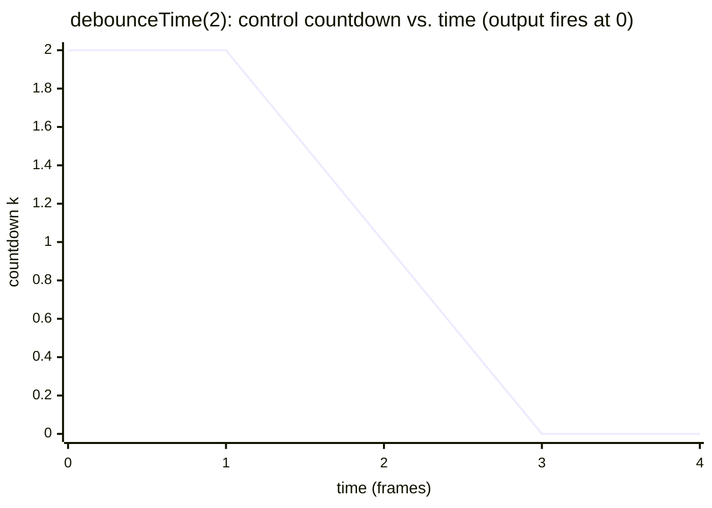

# 06 · State Transition Tables → Four-Lane Timeline → Test Cases

This document closes the loop. A **state transition table (STT)** is nothing more than the
6-tuple written as a relation: one row per `(state, input)` pair, listing the next state and the
emitted output. Once an operator is in table form, two artifacts fall out *mechanically*:

1. A **four-lane timeline** — each executed row becomes one timeline step.
2. A **test suite** — each table row becomes one test case.

```
          6-tuple
             │  (tabulate T and G over S × Σ)
             ▼
   State Transition Table ──────┬───────────────┐
             │ (drive with an    │ (one row =     │
             │  input sequence)  │  one test)     │
             ▼                   ▼                ▼
     Execution Trace       Four-Lane Timeline   Test Cases
```

---

## 1. From 6-tuple to State Transition Table

The STT columns are a direct transliteration of the tuple:

| STT column | 6-tuple component |
|------------|-------------------|
| **Current state** | element of `S` |
| **Input** | symbol of `Σ` (incl. `τ` for timed operators) |
| **Guard** | predicate selecting a `T`/`G` clause |
| **Next state** | `T(s, σ)` |
| **Output** | `G(s, σ) ∈ Λ*` |
| **`|G|`** | output arity (feeds the correspondence theorem) |

Every row is *total* with respect to the states and inputs that are reachable; unreachable
`(s, σ)` pairs are omitted (or marked `—`).

### 1.1 STT for `take(2)`

`S = {C0, C1, Done}` where `Ck = Counting(k)`.

| # | Current | Input | Guard | Next | Output `G` | `|G|` |
|---|---------|-------|-------|------|-----------|-------|
| R1 | C0 | `n(v)` | —        | C1   | `⟨ n(v) ⟩`      | 1 |
| R2 | C1 | `n(v)` | k+1 = n  | Done | `⟨ n(v), c ⟩`   | 2 |
| R3 | C0 | `c`    | —        | Done | `⟨ c ⟩`         | 1 |
| R4 | C1 | `c`    | —        | Done | `⟨ c ⟩`         | 1 |
| R5 | C0 | `e`    | —        | Done | `⟨ e ⟩`         | 1 |
| R6 | C1 | `e`    | —        | Done | `⟨ e ⟩`         | 1 |

The row with `|G| = 2` (**R2**) is the operator's defining behavior — value + synthesized
completion.

### 1.2 STT for `debounceTime(d)` (timed; `τ` in the alphabet)

`S = {Idle, Armed(k), Done}`, state carries pending value `p` and countdown `k`.

| # | Current | Input | Guard | Next | Output `G` | `|G|` |
|---|---------|-------|-------|------|-----------|-------|
| R1 | Idle      | `n(v)` | —      | Armed(d)   | `⟨ ⟩`          | 0 |
| R2 | Armed(k)  | `n(v)` | —      | Armed(d)   | `⟨ ⟩`  (reset) | 0 |
| R3 | Armed(k)  | `τ`    | k > 1  | Armed(k−1) | `⟨ ⟩`          | 0 |
| R4 | Armed(k)  | `τ`    | k = 1  | Idle       | `⟨ n(p) ⟩`     | 1 |
| R5 | Idle      | `τ`    | —      | Idle       | `⟨ ⟩`          | 0 |
| R6 | Armed(k)  | `c`    | —      | Done       | `⟨ n(p), c ⟩`  | 2 |
| R7 | Idle      | `c`    | —      | Done       | `⟨ c ⟩`        | 1 |
| R8 | *         | `e`    | —      | Done       | `⟨ e ⟩`        | 1 |

Rows **R4** (fire on silence) and **R6** (flush on complete) are the behaviorally interesting
ones; the rest are plumbing.

---

## 2. From STT to Execution Trace

Driving the table with a concrete input sequence yields an **execution trace**: an ordered list
of *(virtual time, fired row, state before → after, output)*. The trace is just "which rows
fired, in order, and when."

### 2.1 `debounceTime(2)` driven by `a@0, b@1, (silence), complete@4`

With `d = 2` and one `τ` per time frame:

| t | Input | Row fired | State: before → after | Output |
|---|-------|-----------|-----------------------|--------|
| 0 | `n(a)` | R1 | Idle → Armed(2)       | — |
| 1 | `n(b)` | R2 | Armed(2) → Armed(2)   | — (reset, p=b) |
| 2 | `τ`    | R3 | Armed(2) → Armed(1)   | — |
| 3 | `τ`    | R4 | Armed(1) → Idle       | **n(b)** |
| 4 | `c`    | R7 | Idle → Done           | **c** |

The "Row fired" column is the bridge: the trace is a *sequence of STT row indices*. This makes
the timeline and the tests trivially derivable.

---

## 3. From Execution Trace to the Four-Lane Timeline

The four lanes visualize the same trace from four angles. All lanes share the **same horizontal
time axis** (lane 1), so they align column-by-column.

- **Lane 1 — Time:** the virtual clock / frame axis (`0 1 2 3 4 …`), one tick per `τ`.
- **Lane 2 — Input emissions:** when and what the *source* emits (`n(v)`, `c`, `e`).
- **Lane 3 — Control signal:** the operator's internal control state over time — the thing that
  governs *whether/when* output happens (e.g. the debounce countdown, the buffer window, the
  take counter). This is the visualization of the STT's state + guards.
- **Lane 4 — Output emissions:** the resulting output stream, i.e. lane 2 *gated by* lane 3.

### 3.1 ASCII timeline for `debounceTime(2)` (trace from §2.1)

```
            t:   0     1     2     3     4
                 |     |     |     |     |
Lane 1 TIME     ─┼─────┼─────┼─────┼─────┼──▶  (frames; one τ per frame)

Lane 2 IN       a     b                 |
                ●─────●                  ◆         ● = next   ◆ = complete

Lane 3 CTRL     [arm:2][reset:2][k:1 ][FIRE]       debounce countdown
                ┌─────┬───────────────┐
                │ k=2 │ k=2 │ k=1 │ 0 →│ fire@t3
                └─────┴─────┴─────┴────┘

Lane 4 OUT                        b     |
                                  ●─────◆         emission gated by CTRL
```

Reading the lanes together: two rapid inputs (`a`, `b`) in lane 2 collapse — lane 3 shows the
countdown being **reset** at t=1, reaching zero at t=3, which *gates* lane 4 to emit the latest
value `b` at t=3; `complete` at t=4 flushes through.

### 3.2 Lane semantics per operator family

| Operator | Lane 3 (control signal) encodes | Lane 4 is lane 2 gated by |
|----------|---------------------------------|---------------------------|
| `take(n)`       | remaining count `n−k` | "pass until counter hits 0, then also emit `c`" |
| `filter(p)`     | predicate truth per value | "pass iff `p(v)`" |
| `debounceTime`  | countdown timer `k` | "emit latest when timer reaches 0" |
| `bufferTime`    | window-remaining `k` + buffer size | "emit array when window closes" |
| `windowTime`    | window id + window-remaining | "route into current window; open new on close" |
| `mergeMap`      | live inner set `|I|` | "emit each inner value; complete when `I=∅ ∧ SrcDone`" |

### 3.3 Mermaid rendering of the four lanes (gantt-as-timeline)

Mermaid has no native "4-lane" chart; a `gantt` with four sections renders the alignment well on
GitHub:

```mermaid
gantt
    title debounceTime(2) — four-lane timeline (frames 0..4)
    dateFormat X
    axisFormat %S
    section Lane2 Input
    n(a)            :milestone, 0, 0
    n(b)            :milestone, 1, 0
    complete        :milestone, 4, 0
    section Lane3 Control
    arm k=2         :a1, 0, 1
    reset k=2       :a2, 1, 1
    countdown k=1   :a3, 2, 1
    FIRE k=0        :crit, a4, 3, 1
    section Lane4 Output
    n(b) emitted    :milestone, 3, 0
    complete emitted:milestone, 4, 0
```



For a value-vs-control overlay, a Mermaid `xychart-beta` can plot the control signal (e.g. the
debounce countdown) against time, with output events marked — making lane 3 vs. lane 4 explicit:



The line hits `0` at t=3 — exactly where lane 4 emits.

---

## 4. From STT Rows to Test Cases

Each STT row is an independent behavioral assertion: *"in this state, on this input (under this
guard), the machine must move to that next state and emit that output."* So **row ⇒ test case**
is a one-to-one mapping. Two complementary styles:

- **Unit-of-transition tests** — assert `T`/`G` for a single row in isolation (great coverage
  bookkeeping: one row, one test, 100% row coverage is checkable).
- **Marble tests** — assert an end-to-end trace (a *path* through several rows) against RxJS's
  `TestScheduler`, which is the ground truth.

### 4.1 Row-coverage checklist for `take(2)`

| Row | Scenario | Expected |
|-----|----------|----------|
| R1 | first value           | emits it, stays open |
| R2 | second value          | emits it **and** completes (`|G|=2`) |
| R3 | complete before quota | completes, no synthesized value |
| R4 | complete at C1        | completes |
| R5 | error at C0           | errors |
| R6 | error at C1           | errors |

### 4.2 Row-coverage checklist for `debounceTime(2)`

| Row | Scenario | Expected |
|-----|----------|----------|
| R1 | first value from idle          | arm timer, no output |
| R2 | value while armed              | reset timer, no output (supersede) |
| R3 | tick, timer not yet due        | decrement, no output |
| R4 | tick, timer due                | emit latest value |
| R5 | tick while idle                | nothing |
| R6 | complete while armed           | flush pending, then complete |
| R7 | complete while idle            | complete |
| R8 | error (any state)              | error |

### 4.3 Executable tests

See [`../tests/`](../tests):

- [`tests/take.test.js`](../tests/take.test.js) — one marble test per `take(2)` STT row.
- [`tests/debounceTime.test.js`](../tests/debounceTime.test.js) — one marble test per
  `debounceTime` STT row.
- [`tests/README.md`](../tests/README.md) — how to run them with Node's `node:test` runner +
  RxJS `TestScheduler`.

Each test's name references its STT row (e.g. `R2: second value emits value AND completes`), so a
green suite is a direct, auditable proof that the implementation realizes the tabulated 6-tuple.

---

## 5. The complete pipeline, summarized

| Stage | Artifact | Mechanical rule |
|-------|----------|-----------------|
| 1 | 6-tuple | definition |
| 2 | **State Transition Table** | one row per reachable `(s, σ)`; columns = `T`, `G`, `|G|` |
| 3 | **Execution trace** | drive the STT with an input sequence; record fired rows + time |
| 4 | **Four-lane timeline** | lane1 time · lane2 input · lane3 control(state/guards) · lane4 output = input gated by control |
| 5 | **Test cases** | one test per STT row (unit) + one marble test per trace (path) |

Nothing in stages 3–5 requires creativity: given the table and an input sequence, the timeline
and the tests are *derived*. That derivability is the practical dividend of having modeled the
operator as a 6-tuple in the first place.
